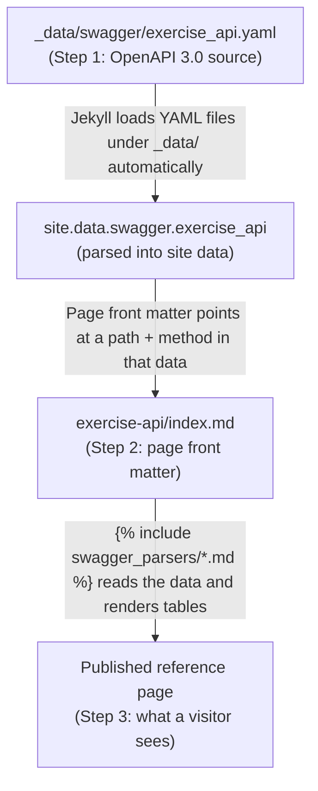

# How the pipeline works
{: .no_toc }
The docs-as-code pipeline that turns an OpenAPI spec into a published reference page.

----------------------

> **Context**
> - **Audience:** Technical writers and developers evaluating docs-as-code approaches for generating API references.
> - **My role:** Adapted an existing Swagger-parsing approach, implementing a YAML-to-published-page workflow.
> - **Tools:** OpenAPI 3.0, YAML, Jekyll data files, Liquid.
> - **Outcome:** [GET /exercises/equipment/{type}]() is generated entirely from the spec file below with YAML edits changing the published page, with no HTML or Markdown to hand-edit.
{: .note }

## Table of contents
{: .no_toc .text-delta }

1. TOC
{:toc}

## Pipeline overview





## Pipeline explained
**Step 1.** Refer to the [exercise API YAML spec file](https://github.com/DeeptiN1/portfolio/tree/main/_data/swagger/exercise_api.yaml).

↓

**Step 2.** See the [source of the published page (exercise-api/index.md)](https://github.com/DeeptiN1/portfolio/blob/main/docs/open-api-spec-example/exercise-api/index.md) that consumes the YAML file, with just front matter and includes, no handwritten reference content.

```yaml
---
title: GET exercises by equipment type
swaggerfile: exercise_api
swaggerkey: /exercises/equipment/{type}
method: get
---
```

```liquid
## Path parameters

```


Each include (`_includes/swagger_parsers/*.md`) reads `site.data.swagger[page.swaggerfile].paths[page.swaggerkey][page.method]` and renders an HTML table from whatever it finds. Add a new operation to the YAML file and reference it from a new page's front matter, and the tables populate themselves, avoiding the need to maintain reference content to keep in sync by hand.

↓

**Step 3.** See the resulting [published page]().

## Manual page vs. auto-generated page

| Aspect | [API documentation]() (manual) | [GET /exercises/equipment/{type}]() (generated) |
|:---|:-------------------------------------------------------------------|:-----------------------------------------------------------------------------------------------------------|
| Source of truth | The Markdown file itself.                                          | `_data/swagger/exercise_api.yaml`                                                                          |
| Narrative content (auth walkthrough, error responses, rate limits) | Handwritten.                                                       | Only what the spec captures.                                                                               |
| Stays in sync with the spec automatically | No. I have to remember to update it.                               | Yes.                                                                                                       |
| Effort to add a new endpoint | Write a full new page.                                             | Add a path to the YAML file, add a short page pointing at it.                                              |
| Best for | A single endpoint that needs real explanation and worked examples. | A larger API surface where maintaining every page manually doesn't scale.                                  |

*In practice, a real API reference usually needs both generated pages for coverage across a large surface, and handwritten pages for the handful of endpoints that need explanation a spec can't carry, like error handling, auth setup, rate limits, and worked examples like the ones on the manual page.*
