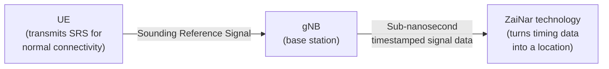

# Product overview of ZaiNar: network-side positioning for physical AI
{: .no_toc }
A portfolio writing exercise providing an explanation-oriented brief on [ZaiNar](https://zainartech.com/), a foundational layer for physical AI, which turns existing 5G network signals into GPS-independent, centimeter-level positioning infrastructure.

--------------------------------

> **Context**
> - **Audience:** Network engineering leads and RF/positioning architects at telecom operators evaluating 5G monetization paths, product and procurement stakeholders assessing indoor asset-tracking options, and partners or investors.
> - **Sources:** ZaiNar's own published materials: [zainartech.com](https://zainartech.com/) and [5G's Killer App](https://zainartech.com/news/5g-killer-app). This overview restates ZaiNar's claims for a portfolio writing exercise.
> - **Documentation type:** Explanation, per the [Diataxis](https://diataxis.fr/explanation/) framework, which is understanding-oriented and discursive, meant to give context and connect ideas.
{: .note }

## Table of contents
{: .no_toc .text-delta }

1. TOC
{:toc}

## The existing problem in positioning for physical AI

**Physical AI:** Physical AI is artificial intelligence that operates in the physical world, rather than behind a computer screen. Every machine or robot in the field wants to know its own location with respect to its environment and the location of other machines in the environment. Physical AI requires sub-meter accuracy and real-time awareness across all connected devices for AI training and AI coordination of movement in three-dimensional space.

**GPS and existing 5G positioning isn't enough to support physical AI:** GPS positioning depends on line-of-sight signals broadcast from satellites roughly 20,000 km away. By the time those signals reach a receiver, they're already weak and easily attenuated by roofs, structural steel, and concrete. That's why GPS degrades or disappears entirely indoors, underground, and in dense urban canyons, where hospitals track equipment, warehouses track inventory, and construction sites track people and machinery.

The same weakness that makes GPS fail indoors also makes it easy to disrupt outdoors. Because the signal arriving at a receiver is so faint, a comparatively low-power jammer can deny a fix over a wide area and spoofing can feed a receiver a false position it has no way to independently check.

Existing 5G positioning doesn't fully close this gap either. Standard approaches rely on dedicated Positioning Reference Signals (PRS/PSRS) that depend on device software and Original Equipment Manufacturer (OEM) cooperation to transmit. Carriers can't always get that cooperation since Apple and Google restrict app and carrier access to location APIs on the handset side.

## ZaiNar's network-side approach to physical AI positioning

ZaiNar's approach centers on a signal every device already has to send. Every device transmits a Sounding Reference Signal (SRS) not to report its location, but simply to maintain its connection to the network. 

ZaiNar's approach repurposes this existing, mandatory signal. Instead of asking the device to cooperate in locating itself, the network listens to the connectivity signal it's already receiving and derives position from the timing of that signal across multiple base stations. Because SRS is a signal the device must transmit to stay connected, ZaiNar's approach is a network function rather than a handset function.

This approach connects back to solving the problem preceding this section:

- **No handset gatekeeper to get past.** Because SRS is a connectivity signal rather than a dedicated positioning signal, there's no OEM permission or device-side software needed.
- **No satellite dependency.** Positioning happens entirely within the terrestrial network, so the indoor/underground blind spot that defines the GPS problem doesn't apply in the same way.

ZaiNar's network-side approach delivers the following features:

- **Sub-10 cm 3D accuracy:** Outdoors, indoors, underground, and in GPS-denied environments, built on sub-nanosecond network time synchronization.
- **Zero device or hardware changes:** Runs entirely as network-side software. No added battery drain on the tracked device.
- **100–500 location updates per second:** Fast enough to track drones, vehicles, and robots, not just stationary assets, versus standard 5G sending positioning reference signals (PRS/PSRS) roughly once per second.
- **As little as 10 MHz of spectrum:** The only 5G positioning approach workable on bandwidth-constrained private 5G and low-power 5G IoT networks.
- **Self-calibrating:** Accuracy improves over time as the system learns each new deployment environment.
- **Carrier- and protocol-agnostic:** The same network-side logic as extending to Wi-Fi and other radio protocols, not just 5G.

This device-side-to-network-side shift is a power, compute, and security improvement for the 5G network itself in addition to    providing a positioning upgrade.

## How ZaiNar achieves sub-10 cm positioning

At a high level, there are three components that do the work: the device, the base stations that hear it, and ZaiNar's technology that turns timing data into a location.

*The diagram is simplified and shows the signal path through a single base station for clarity. In practice, the location calculation needs the same SRS transmission heard by several synchronized gNBs, not just one.*

**UE** (User Equipment) is the device, for example, a phone, robot, vehicle, or IoT sensor. 

**gNB** (gNodeB) is the 5G base station.

The reasoning behind the resulting accuracy is straightforward physics once the synchronization problem is solved. Radio waves travel about 30 cm per nanosecond, so if the network can timestamp a signal's arrival at multiple base stations to within a fraction of a nanosecond, it can calculate position to within a few centimeters.

ZaiNar reports the following results from its own testing:

- Sub-10 cm accuracy, demonstrated on CBRS Band 48 networks using 20 MHz of bandwidth.
- 2+ km range.
- Zero additional battery drain on tracked devices.

## Supporting physical AI: what this enables

ZaiNar provides infrastructure for "Physical AI," which is the idea that AI systems coordinating movement in the physical world (robots, autonomous equipment, tracked assets) need continuous, high-confidence location data the way language models need text. The positioning engine is a bid to make the 5G network itself a sensing layer that other systems can build on, in the same way connectivity itself became infrastructure other products assumed was simply there.

Instead of each robot or machine building and maintaining its own independent map of a site, ZaiNar positions the network as a shared, external source that every machine on site can draw from, complementing each robot's own on-device perception. ZaiNar describes three capabilities that follow from that shift:

- **Training.** Grounding robot models in how people, equipment, and vehicles actually move through real sites.
- **Swarm enablement.** Every machine knows the position of every other machine and can coordinate optimized movements.
- **Environmental memory.** A persistent record of a site that new machines inherit, instead of mapping the space from scratch.

## Where ZaiNar is headed

In 2026, ZaiNar announced it had joined [Arm's "Total Design for Physical AI" program](https://zainartech.com/news/arm-total-design) as a founding location partner, contributing this shared-positioning layer to an ecosystem aimed at reducing integration complexity for autonomous-systems builders on Arm-based compute.

## Sources

- [zainartech.com](https://zainartech.com/)
- [ZaiNar: "5G's Killer App"](https://zainartech.com/news/5g-killer-app)
- [ZaiNar: "Arm Total Design"](https://zainartech.com/news/arm-total-design)
- [Diataxis—Explanation](https://diataxis.fr/explanation/), the documentation framework used to scope this brief's content.
