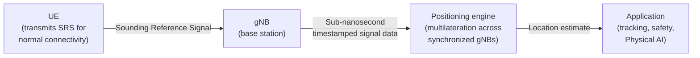

# ZaiNar solutions brief
{: .no_toc }
An explanation-oriented brief on how [ZaiNar](https://zainartech.com/) turns existing 5G network signals into GPS-independent, centimeter-level positioning infrastructure.

--------------------------------

> **Context**
> - **Audience:** Network engineering leads and RF/positioning architects at telecom operators evaluating 5G monetization paths; product and procurement stakeholders at industrial and enterprise companies (healthcare, construction, logistics, smart cities) assessing indoor asset-tracking options; and partners or investors doing first-pass technical diligence on ZaiNar's public claims.
> - **Sources:** ZaiNar's own published materials—[zainartech.com](https://zainartech.com/) and ["5G's Killer App"](https://zainartech.com/news/5g-killer-app). This brief restates ZaiNar's claims for a portfolio writing exercise; it is not an independent benchmark, and any number below without a cited third party is a vendor claim, not a verified fact.
> - **Documentation type:** Explanation, per the [Diataxis](https://diataxis.fr/explanation/) framework—understanding-oriented and discursive, meant to give context and connect ideas rather than instruct step by step. This brief intentionally stays out of how-to or reference territory (no setup steps, no API parameters).
{: .note }

## Table of contents
{: .no_toc .text-delta }

1. TOC
{:toc}

## The problem: GPS alone isn't enough

GPS positioning depends on line-of-sight signals broadcast from satellites roughly 20,000 km away. By the time those signals reach a receiver, they're already weak—easily attenuated by roofs, structural steel, and concrete. That's why GPS degrades or disappears entirely indoors, underground, and in dense urban canyons: exactly the environments where hospitals track equipment, warehouses track inventory, and construction sites track people and machinery.

The same weakness that makes GPS fail indoors also makes it easy to disrupt outdoors. Because the signal arriving at a receiver is so faint, a comparatively low-power jammer can deny a fix over a wide area, and spoofing can feed a receiver a false position it has no way to independently check. **[PLACEHOLDER: cite a third-party source—for example, GPS.gov or a DOT/FAA advisory—for jamming range and spoofing-incident figures before using this brief outside a portfolio context.]**

Existing 5G positioning doesn't fully close this gap either: standard approaches rely on dedicated Positioning Reference Signals (PRS/PSRS) that depend on device software and OEM cooperation to transmit—cooperation that carriers can't always get, since Apple and Google restrict app and carrier access to location APIs on the handset side.

## Why network-side positioning is a different approach

Every device already transmits a Sounding Reference Signal (SRS)—not to report its location, but simply to maintain its connection to the network. ZaiNar's approach repurposes that existing, mandatory signal: instead of asking the device to cooperate in locating itself, the network listens to the connectivity signal it's already receiving and derives position from the timing of that signal across multiple base stations.

This reframing matters for three reasons that connect back to the problem preceding this list:

- **No handset gatekeeper to get past.** Because SRS is a connectivity signal rather than a dedicated positioning signal, there's no OEM permission or device-side software needed—sidestepping the access restrictions that limit PRS/PSRS-based approaches.
- **No satellite dependency.** Positioning happens entirely within the terrestrial network, so the indoor/underground blind spot that defines the GPS problem doesn't apply in the same way.
- **Harder to deny than GPS.** Jamming a satellite signal from the ground is comparatively easy because the receiver has one faint, predictable source to drown out. Disrupting a signal the device must keep transmitting just to stay connected to a nearby base station is a different, and reportedly harder, problem—though ZaiNar does not publish independent resilience testing against jamming, so this is a reasoned inference from the architecture, not a measured claim.

## How it fits together

At a high level, three components do the work: the device, the base stations that hear it, and a positioning engine that turns timing data into a location.

*Simplified: in practice, multilateration needs the same SRS transmission heard by several synchronized gNBs, not just one—the diagram shows the signal path through a single base station for clarity.*

The reasoning ZaiNar gives for the resulting accuracy is straightforward physics once the synchronization problem is solved: radio waves travel about 30 cm per nanosecond, so if the network can timestamp a signal's arrival at multiple base stations to within a fraction of a nanosecond, it can triangulate position to within a few centimeters. The harder engineering problem—and the one ZaiNar presents as its core differentiator—is getting that sub-nanosecond synchronization across a live network in the first place, rather than the positioning math itself.

## Alternatives and trade-offs

ZaiNar positions its approach against several existing location technologies—GPS RTK, Ultra-Wideband (UWB), Wi-Fi, Bluetooth, and RFID—and claims to outperform all of them. That's a vendor claim stated without a published head-to-head benchmark, so it's worth holding separately from the architectural reasoning preceding it:

| Alternative | Typical constraint it's compared against | ZaiNar's stated position |
|---|---|---|
| GPS / GPS RTK | Needs sky visibility; RTK adds a correction network and still fails indoors | Claims to match or beat RTK accuracy without sky visibility |
| UWB | High accuracy, but needs purpose-built anchors and tags installed throughout a facility | Claims comparable accuracy using infrastructure that (per ZaiNar) already exists |
| Wi-Fi / Bluetooth | Widely deployed, but accuracy is typically meter-level, not centimeter-level | Claims to exceed both on accuracy |
| RFID | Good for presence/proximity, weak for continuous precise tracking | Claims to exceed on continuous tracking precision |

**[PLACEHOLDER: this comparison restates ZaiNar's own positioning against each alternative; no independent benchmark report is cited. Before using this table externally, source a third-party test (analyst report, published trial, or customer case study with named methodology) for each row.]**

## Performance claims to verify before citing externally

The following figures are stated directly on ZaiNar's site. They're reproduced here as-is for the brief, each flagged with its source and verification status—not vetted against an independent source.

| Claim | Value as stated by ZaiNar | Verification status |
|---|---|---|
| Positioning accuracy | Sub-10 cm, demonstrated on CBRS Band 48, 20 MHz bandwidth | Self-reported; **[PLACEHOLDER: link an independent test report before quoting in a proposal]** |
| Range | 2+ km | Self-reported; conditions (spectrum, line-of-sight, gNB density) not specified—**[PLACEHOLDER]** |
| Update rate | 100–500 position fixes/second, vs. roughly 1/second for PRS/PSRS | Self-reported |
| Minimum spectrum required | 10 MHz | Self-reported |
| Device battery impact | "Zero additional drain" | Self-reported; no independent power-draw measurement cited—**[PLACEHOLDER]** |
| Time-sync precision | "1,000x more precise than conventional network time synchronization" | Self-reported; baseline for "conventional" undefined—**[PLACEHOLDER: confirm the comparison standard]** |
| Commercial traction | $450M+ in contracts; deployments in healthcare, construction, logistics, and smart cities across multiple continents | Self-reported; customer names, deployment count, and dates not disclosed—**[PLACEHOLDER: request customer references]** |
| Funding / valuation | $100M+ invested; $1 billion+ valuation; backers cited include Samsung and SoftBank | Self-reported; **[PLACEHOLDER: confirm against a funding announcement or press release, and confirm it's still current as of the publish date]** |

## Where this is headed

ZaiNar frames this capability as infrastructure for "Physical AI"—the idea that AI systems coordinating movement in the physical world (robots, autonomous equipment, tracked assets) need continuous, high-confidence location data the way language models need text. Read in that context, the positioning engine isn't just a GPS backup; it's a bid to make the 5G network itself a sensing layer that other systems can build on, in the same way connectivity itself became infrastructure other products assumed was simply there.

Whether that broader framing holds will depend on evidence this brief doesn't have: independent accuracy benchmarks, named customer deployments, and jamming-resilience testing against a defined threat model. The placeholders throughout this brief mark exactly that gap.

## Sources

- [zainartech.com](https://zainartech.com/)
- [ZaiNar: "5G's Killer App"](https://zainartech.com/news/5g-killer-app)
- [Diataxis—Explanation](https://diataxis.fr/explanation/), the documentation framework used to scope this brief's content
